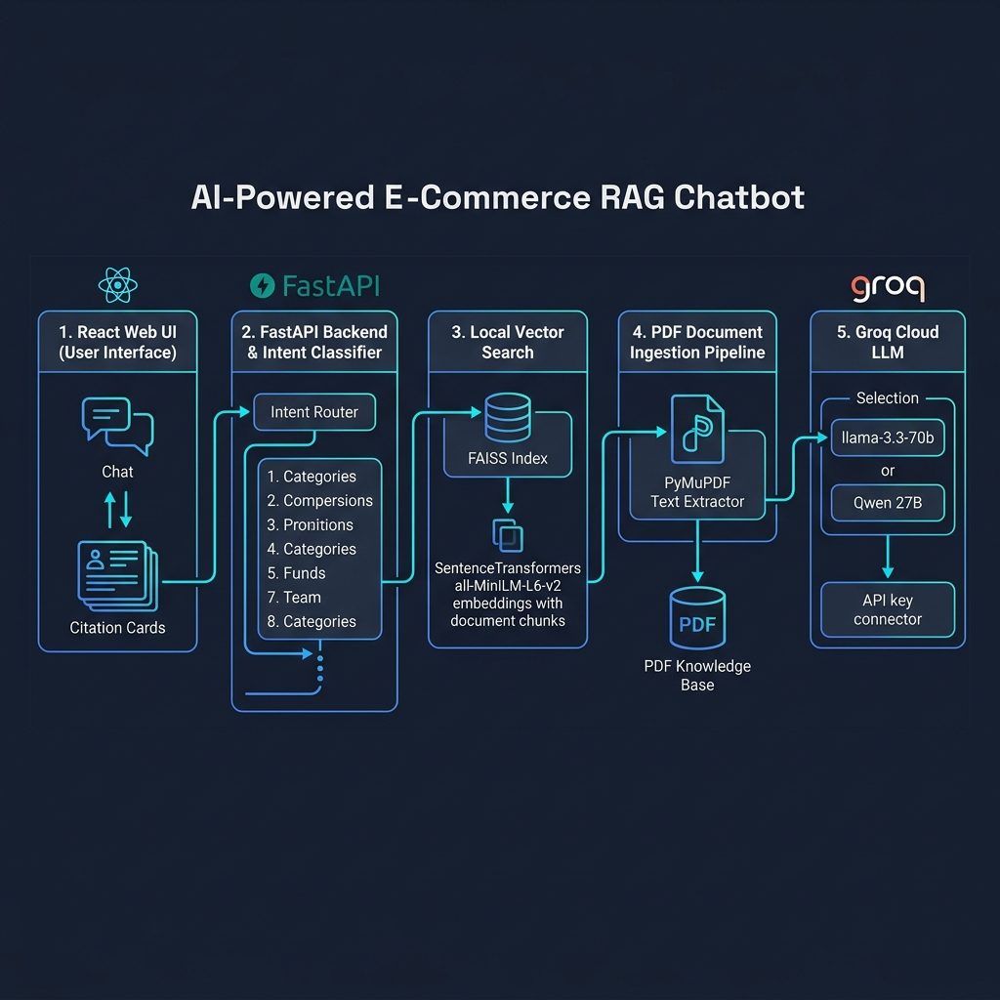
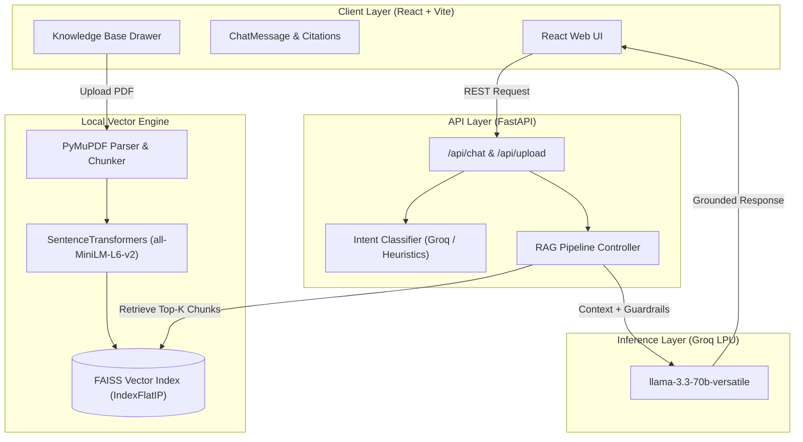

<div align="center">

# 🛍️ AI-Powered E-Commerce RAG Assistant
### *Enterprise-Grade Retrieval-Augmented Generation for Fact-Grounded Customer Support*

<p align="center">
  <a href="https://github.com/tilak-bytes/ecommerce-rag-chatbot/stargazers"></a>
  <a href="https://github.com/tilak-bytes/ecommerce-rag-chatbot/network/members"></a>
  <a href="https://github.com/tilak-bytes/ecommerce-rag-chatbot/blob/main/LICENSE"></a>
  <a href="https://fastapi.tiangolo.com/"></a>
  <a href="https://react.dev/"></a>
  <a href="https://groq.com/"></a>
  <a href="https://github.com/facebookresearch/faiss"></a>
</p>

<p align="center">
  <b>A full-stack, production-ready AI Assistant designed to eliminate hallucinations, enforce domain guardrails, and provide verified page citations across store catalogs, return policies, and shipping FAQs.</b>
</p>

<p align="center">
  <a href="#-system-architecture">Architecture</a> •
  <a href="#-key-features">Features</a> •
  <a href="#-why-this-over-vanilla-rag">Why This Architecture?</a> •
  <a href="#-quick-start">Quick Start</a> •
  <a href="#-api-reference">API Reference</a> •
  <a href="#-tech-stack">Tech Stack</a>
</p>

---

</div>

<p align="center">
  
</p>

---

## ⚡ Overview

Most customer support chatbots suffer from **hallucinations**, **high latency**, and **opaque answering without sources**. 

This system solves these issues through a decoupled **FastAPI + React** architecture featuring:
1. **Local Privacy-Preserving Search:** Embeddings are generated on-device with `all-MiniLM-L6-v2` and searched through **Meta FAISS**, ensuring proprietary data never leaves your environment during retrieval.
2. **Sub-Second LLM Synthesis:** Leverages **Groq LPUs** (`llama-3.3-70b-versatile`) to deliver near-instantaneous streaming answers.
3. **Intent-Guided Guardrails:** Dynamically classifies queries into **8 distinct intents** to inject context-specific guardrails before synthesis.
4. **Verifiable Citations:** Every claim is paired with exact PDF file references and 1-indexed page numbers for full auditability.

---

## 🏆 Why This Over "Vanilla" RAG?

| Feature | Standard / Toy RAG | This System |
|---|---|---|
| **Query Routing** | ❌ None (blind semantic search) | ✅ **8-Class Intent Classifier** with dynamic prompt routing |
| **Hallucination Protection** | ❌ Relies solely on system prompt | ✅ **Strict Context Isolation + Negative Constraint Enforcing** |
| **Source Provenance** | ❌ Generic text answers | ✅ **Page-by-page metadata citations** displayed in UI |
| **Embeddings & Search** | ⚠️ Expensive cloud embedding APIs | ✅ **100% Local Inference** via SentenceTransformers + FAISS |
| **Document Management** | ❌ Static script ingestion | ✅ **Dynamic Multi-PDF Uploader & Live Vector Re-indexer** |
| **User Interface** | ⚠️ Basic CLI or simple Streamlit | ✅ **Modern React + Vite + Tailwind CSS** with intent badges |

---

## 🚀 Key Features

### 1. 🛡️ Dynamic Multi-Intent Prompt Routing
Queries are classified into 8 domain intents to dynamically inject specialized guardrails into the prompt before calling the LLM:
- `faq`: Platform usage, payment methods, accounts, and policies.
- `product_question`: Hardware specifications, sizing charts, warranties, and stock checks.
- `product_recommendation`: Strictly limited to products explicitly present in the vector context.
- `review_summary`: Summarizes verified customer feedback without fabricating sentiment.
- `order_shipping`: Courier tracking, dispatch windows, and shipping tier policies.
- `returns_refunds`: Return windows, condition requirements, and refund SLA dates.
- `general_support`: Contact info, store hours, and escalation pathways.
- `unknown`: Gracefully handles out-of-scope inquiries without hallucinating.

### 2. 📑 Precision PDF Chunking & Retrieval
- **PyMuPDF Ingestion:** Preserves page boundaries and document metadata during ingestion.
- **Overlapping Semantic Chunks:** 500-character windows with 100-character overlap maintain paragraph semantics.
- **Cosine Similarity via FAISS:** Chunks are normalized and indexed with `IndexFlatIP` for mathematical cosine similarity search.

### 3. 🎨 Modern Interactive Web Interface
- White & Mid-Blue clean enterprise aesthetic (`#2563EB`).
- Source citation cards with document name, page number, and snippet previews.
- Intent chip indicators showing active query classification.
- Sidebar Knowledge Base Manager for uploading custom PDFs or resetting to default indices.

---

## 🏗️ System Architecture



---

## 🛠️ Technology Stack

<div align="center">

| Layer | Technologies |
|---|---|
| **Backend & API** | `Python 3.10+`, `FastAPI`, `Uvicorn`, `Pydantic v2` |
| **Embeddings & Vector Store** | `SentenceTransformers (all-MiniLM-L6-v2)`, `Meta FAISS (IndexFlatIP)` |
| **Document Processing** | `PyMuPDF (fitz)`, Python hashlib |
| **LLM & Inference** | `Groq API (llama-3.3-70b-versatile, llama-3.1-8b-instant)` |
| **Frontend Framework** | `React 18`, `Vite`, `Tailwind CSS`, `Lucide React` |
| **DevOps & Tracking** | `Git`, `GitHub` |

</div>

---

## ⚡ Quick Start

### 1. Prerequisites
- **Python 3.10+** (Python 3.11 or 3.12 recommended)
- **Node.js 18+** & **npm 9+**
- Free **Groq API Key** from [console.groq.com](https://console.groq.com/)

---

### 2. Backend Setup

```bash
# 1. Navigate to backend directory
cd backend

# 2. Create and activate a virtual environment
python -m venv venv
# Windows (PowerShell):
.\venv\Scripts\Activate.ps1
# macOS / Linux:
source venv/bin/activate

# 3. Install dependencies
pip install -r requirements.txt

# 4. Configure environment variables
cp .env.example .env
```

Open `.env` and configure your credentials:
```env
GROQ_API_KEY=gsk_your_groq_api_key_here
GROQ_MODEL=llama-3.3-70b-versatile
EMBEDDING_MODEL=all-MiniLM-L6-v2
```

Start the FastAPI server:
```bash
uvicorn app.main:app --reload --port 8000
```
> Server will boot at **`http://localhost:8000`** with interactive Swagger documentation at **`http://localhost:8000/docs`**.

---

### 3. Frontend Setup

In a new terminal window:

```bash
# 1. Navigate to frontend directory
cd frontend

# 2. Install dependencies
npm install

# 3. Start development server
npm run dev
```
> The application will open at **`http://localhost:5173`**.

---

## 📡 API Reference

| Endpoint | Method | Description |
|---|---|---|
| `/api/health` | `GET` | Returns vector store status, indexed chunk counts, and Groq readiness |
| `/api/chat` | `POST` | Ingests user query + history, routes intent, and returns fact-grounded answer with citations |
| `/api/documents` | `GET` | Lists all indexed knowledge-base documents and metadata |
| `/api/upload` | `POST` | Ingests a new PDF, extracts text, chunks, embeds, and updates FAISS index |
| `/api/reset-index` | `POST` | Purges custom uploads and resets vector index back to default store knowledge base |

---

## 📂 Project Structure

```text
ecommerce-rag-chatbot/
├── backend/
│   ├── app/
│   │   ├── api/
│   │   │   └── routes.py            # FastAPI REST endpoints
│   │   ├── services/
│   │   │   ├── document_service.py  # PyMuPDF extraction & chunking
│   │   │   ├── groq_service.py      # Groq LPU API client & model fallbacks
│   │   │   ├── intent_service.py    # 8-intent classification engine
│   │   │   └── rag_service.py       # FAISS vector indexing & RAG synthesis
│   │   ├── config.py                # App configuration & environment settings
│   │   ├── main.py                  # FastAPI lifespan & middleware entrypoint
│   │   └── models.py                # Pydantic schemas & response models
│   ├── data/
│   │   ├── uploads/                 # Storage for uploaded PDF documents
│   │   └── vector_store/            # FAISS index and chunk metadata JSON
│   ├── requirements.txt             # Python dependencies
│   └── .env.example                 # Environment template
├── frontend/
│   ├── src/
│   │   ├── components/              # UI components (Header, Chat, Upload, Citations)
│   │   ├── services/                # Axios/Fetch API client bindings
│   │   ├── App.jsx                  # Main chat layout and state orchestrator
│   │   └── index.css                # Tailwind CSS stylesheets
│   ├── package.json                 # Node scripts & dependencies
│   └── vite.config.js               # Vite bundler & reverse proxy configuration
├── docs/
│   ├── architecture.md              # Detailed architecture documentation
│   └── architecture_diagram.png     # Visual system diagram
├── ecommerce_chatbot_kb.pdf         # Default store knowledge base PDF
└── README.md                        # Master documentation
```

---

## 🔒 Privacy & Security

- **Local Vector Processing:** All PDF text parsing, embedding generation, and vector index matching take place **100% locally** on the host machine.
- **Minimal External Transmission:** Only the top-$k$ retrieved text snippets and the user's specific prompt are transmitted to the Groq API during final answer generation.
- **Zero Data Ingestion for Training:** Groq API does not use API inputs or outputs to train foundation models.

---

## 👨‍💻 Author

<div align="center">

**Tilak Verma**  
[](https://github.com/tilak-bytes)
[](https://linkedin.com/in/tilak-bytes)

*Contributions, stars, and pull requests are warmly welcomed!*

</div>
